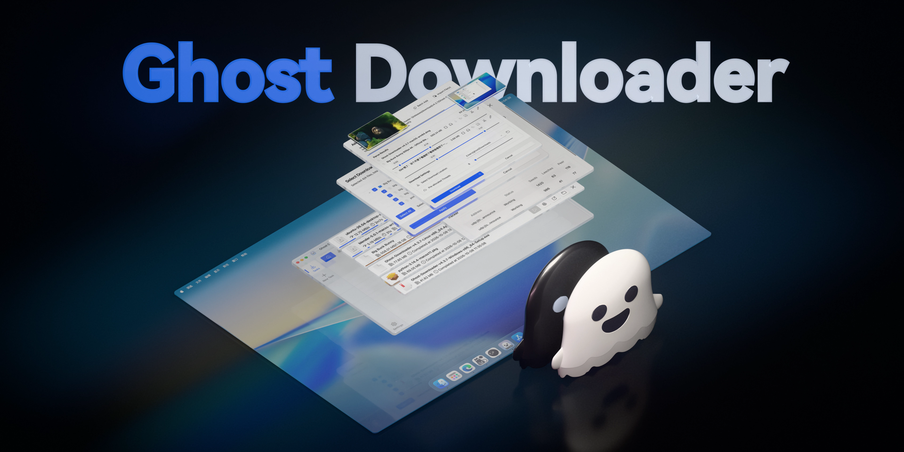
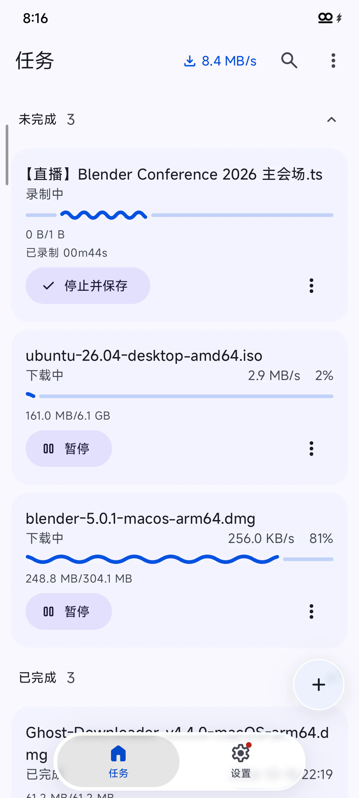
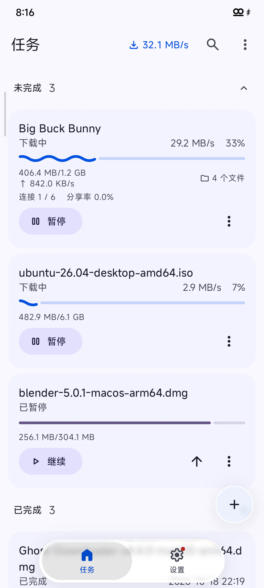
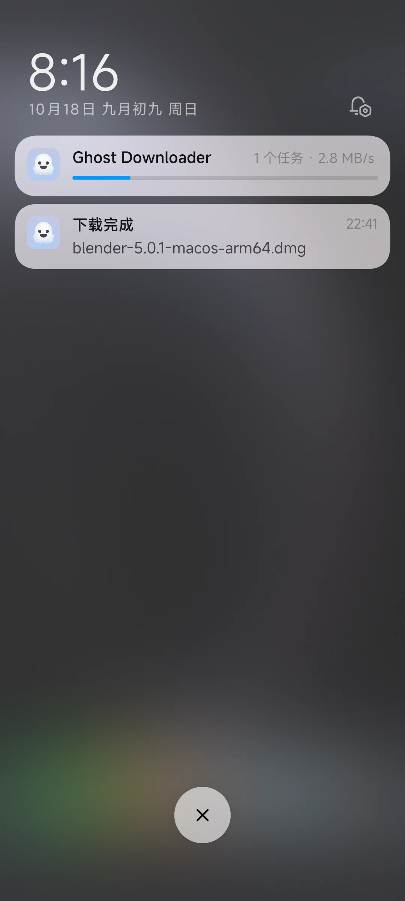

<h4 align="right">
  <a href="README_zh.md">简体中文</a> | <a href="README.md">English</a> | 日本語
</h4>

> [!TIP]
> Ghost Downloader の Discord コミュニティに参加しましょう: [discord.gg/fKfhkPumEM](https://discord.gg/fKfhkPumEM)

<!-- PROJECT LOGO -->
<div align="center">



<a href="https://trendshift.io/repositories/13847" target="_blank"></a>

## あなたに必要なダウンローダーは、これだけ

[![Forks][forks-shield]][forks-url]
[![Stargazers][stars-shield]][stars-url]
[![Issues][issues-shield]][issues-url]
[![Release][release-shield]][release-url]
[![Downloads][downloads-shield]][release-url]
[![AtomGit Downloads][atomgit-downloads-shield]][atomgit-downloads-url]
[](https://qm.qq.com/q/gPk6FR1Hby)
[](https://discord.gg/fKfhkPumEM)

##### [ドキュメント](https://gd.xychr.com/en/docs/) · [動画を見る](https://www.youtube.com/watch?v=QQRa8nDmNbc) · [バグを報告](https://github.com/XiaoYouChR/Ghost-Downloader-3/issues/new?template=bug_report.yml) · [機能をリクエスト](https://github.com/XiaoYouChR/Ghost-Downloader-3/issues/new?template=feature_request.yml)

</div>

<!-- FEATURES -->
## 特長

* **肝心なところで速い。** 回線が良ければ、どのダウンローダーも速く動きます。本当の試金石は、悪い回線です。ファイルの結合が不要なスマートなチャンク分割。帯域幅を自動で検出。本物のブラウザーの TLS フィンガープリントを使うので、ボット対策のチェックには見えません。
* **5 つのアプリの代わりに 1 つで。** すべてを 1 か所にまとめ、機能は一切薄めていません。`HTTP`、`Magnet/BT`、`FTP`、`M3U8`、`MPEG-DASH`、`eD2k` に対応。`YouTube` と `Bilibili` では、クリップの選択、好きな画質と字幕、プレイリストや複数パートのエピソードに対応。`GitHub` と `HuggingFace` はミラーによる高速化に対応。
* **見つけて、検出して、ダウンロード。** ダウンロードボタンが動画に付いてきて、好きな画質を選べます。拡張機能のポップアップには、ページ上のすべてのメディアが一覧で表示されます。そこでクリックするか、いつもどおりにダウンロードすれば、デスクトップアプリがシームレスに引き継ぎます。リンクをコピーする必要はなく、認証状態も引き継がれます。
* **どのプラットフォームでもネイティブ。** 細部に表れます。1 つのアプリで 4 つのシステムに対応し、どこでもネイティブな使い心地です。Android では、ライブの M3U8 ストリームを録画でき、バックグラウンドでもダウンロードを続けます。
* **常に主導権はあなたに** 手間なく。サードパーティ製ツール向けの `aria2` 互換 RPC API。ダウンロードの途中でも、URL、ヘッダー、プロキシを変更できます。進捗が失われることはありません。

<!-- ABOUT THE PROJECT -->
## プロジェクトについて

Bilibili のクリエイターがリソースを管理するのを助けたいという、情熱から始まったプロジェクトです。現在は 4 つのプラットフォームで提供され、ほぼすべてのダウンロードプロトコルを扱い、Feature Packs というプラグインのエコシステムも成長しています。

| プラットフォーム | 必要なバージョン | アーキテクチャ |
|:--|:--|:--|
|  **Windows** | `10+` | `x86_64` / `arm64` |
|  **macOS** | `13.0+` | `x86_64` / `arm64` |
|  **Linux** | `glibc 2.35+` | `x86_64` / `arm64` |
|  **Android** | `9.0+` | `arm64-v8a` |

> [!WARNING]
> Qt `6.6+` は、`AVX` 命令セットを持たない CPU をサポートしなくなりました。

> [!TIP]
> **Arch Linux AUR に対応**: コミュニティが保守するパッケージ `ghost-downloader-bin` と `ghost-downloader-git` が利用できるようになりました(メンテナー: [@zxp19821005](https://github.com/zxp19821005))

<!-- SCREEN SHOTS -->
## スクリーンショット

https://github.com/user-attachments/assets/d97dc8c9-f320-4645-8dcd-0d9dc4cf2eab


<p>
  <picture>
    <source media="(prefers-color-scheme: dark)" srcset=".github/assets/android-recording-dark.webp" />
    
  </picture>
  <picture>
    <source media="(prefers-color-scheme: dark)" srcset=".github/assets/android-tasks-dark.webp" />
    
  </picture>
  <picture>
    <source media="(prefers-color-scheme: dark)" srcset=".github/assets/android-notification-dark.webp" />
    
  </picture>
</p>

<!-- COMMAND LINE -->
## コマンドライン

`ghd` は、**設定 -> コマンドラインツール**からインストールします。

| コマンド | 説明 |
|:--|:--|
| `ghd probe <url>` | タスクを追加せずに URL をプレビューします |
| `ghd add <url>...` | タスクを追加して開始します |
| `ghd tasks` | タスクを一覧表示します |
| `ghd task <taskId>` | タスクの詳細を表示します |
| `ghd pause <taskId>...` | タスクを一時停止します |
| `ghd start <taskId>...` | タスクを再開します |
| `ghd remove <taskId>...` | タスクを削除し、未完了のファイルを削除します |
| `ghd wait <taskId>...` | タスクの完了を待ちます |

```sh
# see which files the torrent contains
ghd probe "https://example.com/a.torrent"
# download only files 0 and 3 into ./downloads
ghd add "https://example.com/a.torrent" --select 0,3 -o ./downloads
# wait until the download finishes
ghd wait tsk_0123
```

<!-- ROADMAP -->
## ロードマップ

- [ ] プラグイン API を公開する(Feature Packs の仕組みは稼働中で、API は安定化の途中)
- [ ] 1 つのタスクに複数の Session を紐付けるなど、タスク編集の強化

リクエストされているすべての機能(と既知の問題)は、[Open issues](https://github.com/XiaoYouChR/Ghost-Downloader-3/issues) をご覧ください。

<!-- SPONSOR -->
## スポンサー

| ロゴ | 説明 |
|------|---|
| <a href="https://signpath.org/"></a> | [SignPath.io](https://about.signpath.io/) による無料のコード署名の提供。証明書は [SignPath Foundation](https://signpath.org/) によるものです |
| <a href="https://i0ntempest.com/"></a> | [i0ntempest.com](https://i0ntempest.com/) による無料のコード署名の提供 |

<!-- CONTRIBUTING -->
## コントリビュート

コントリビュートがあるからこそ、オープンソースコミュニティは学び、刺激を受け、ものを作れるすばらしい場所になります。あなたのコントリビュートは**心から歓迎します**。

ご提案があれば、リポジトリを fork してプルリクエストを作成してください。"Enhancement" タグを付けて issue を立てるだけでも構いません。プロジェクトへの Star もお忘れなく! 重ねてありがとうございます!

1. プロジェクトを Fork する
2. 機能ブランチを作成する(git checkout -b feature/AmazingFeature)
3. 変更をコミットする(git commit -m 'Add some AmazingFeature')
4. ブランチを Push する(git push origin feature/AmazingFeature)
5. プルリクエストを作成する

このプロジェクトに参加してくださったすべてのコントリビューターに感謝します!

[](https://github.com/XiaoYouChR/Ghost-Downloader-3/graphs/contributors)

## 翻訳のコントリビューター

> [!TIP]
> Ghost Downloader の翻訳にご協力いただける方は、ぜひ Crowdin プロジェクトにご参加ください: [ghost-downloader](https://crowdin.com/project/ghost-downloader)

<!-- CROWDIN-CONTRIBUTORS-START -->
<table>
  <tbody>
    <tr>
      <td align="center" valign="top">
        <a href="https://crowdin.com/profile/XiaoYouChR">
          <br />
          <sub><b>XiaoYouChR</b></sub></a>
        <br />
        <sub><b>14249 words</b></sub>
      </td>
      <td align="center" valign="top">
        <a href="https://crowdin.com/profile/i0ntempest">
          <br />
          <sub><b>i0ntempest</b></sub></a>
        <br />
        <sub><b>1988 words</b></sub>
      </td>
      <td align="center" valign="top">
        <a href="https://crowdin.com/profile/ReM2812">
          <br />
          <sub><b>ReM2812</b></sub></a>
        <br />
        <sub><b>1010 words</b></sub>
      </td>
      <td align="center" valign="top">
        <a href="https://crowdin.com/profile/Dima88888">
          <br />
          <sub><b>Dima88888</b></sub></a>
        <br />
        <sub><b>115 words</b></sub>
      </td>
    </tr>
  </tbody>
</table>
<!-- CROWDIN-CONTRIBUTORS-END -->

<!-- LICENSE -->
## ライセンス

GPL v3.0 ライセンスのもとで配布されています。詳細は `LICENSE` をご覧ください。

Copyright © 2023-2026 XiaoYouChR.

<!-- CONTACT -->
## 連絡先

> [!IMPORTANT]
> Ghost Downloader のユーザーグループへのご参加をお待ちしています: [756042420](https://qm.qq.com/q/gPk6FR1Hby)

* [E-mail](mailto:XiaoYouChR@qq.com) - XiaoYouChR@qq.com

<!-- ACKNOWLEDGMENTS -->
## 参考プロジェクト

* [aioftp](https://github.com/aio-libs/aioftp) asyncio 向けの FTP クライアント/サーバー
* [cat-catch](https://github.com/xifangczy/cat-catch) ブラウザーのリソース検出拡張機能
* [desktop-notifier](https://github.com/samschott/desktop-notifier) クロスプラットフォームのデスクトップ通知のための Python ライブラリ
* [FFmpeg](https://ffmpeg.org/) 音声と動画の録画、変換、ストリーミングのための、完全なクロスプラットフォームのソリューション
* [Kelpie](https://github.com/XiaoYouChR/Kelpie) Ghost Downloader の eD2k 対応を支える eD2k ダウンロードエンジン
* [libtorrent](https://github.com/arvidn/libtorrent) 効率的で機能が完全な C++ の BitTorrent 実装
* [loguru](https://github.com/Delgan/loguru) Python での快適なロギングを目指すライブラリ
* [m3u8](https://github.com/globocom/m3u8) Python の m3u8 パーサー
* [mpegdash](https://github.com/sangoma/mpegdash) MPEG-DASH の MPD パーサー
* [N_m3u8DL-RE](https://github.com/nilaoda/N_m3u8DL-RE) Ghost Downloader の M3U8 対応を支える、クロスプラットフォームの DASH/HLS/MSS ダウンロードツール
* [Nuitka](https://github.com/Nuitka/Nuitka) Python コンパイラー
* [PyQt-Fluent-Widgets](https://github.com/zhiyiYo/PyQt-Fluent-Widgets) 強力で拡張性が高く、エレガントな Fluent Design スタイルのウィジェットライブラリ
* [PySide6](https://github.com/PySide/pyside-setup) 公式の Python モジュール
* [QuickJS-NG](https://github.com/quickjs-ng/quickjs) 小型で組み込み可能な JavaScript エンジン
* [uvloop](https://github.com/MagicStack/uvloop) 超高速な asyncio のイベントループ
* [winloop](https://github.com/Vizonex/Winloop) Windows 向けの uvloop の代替
* [wreq](https://github.com/0x676e67/wreq-python) TLS フィンガープリントのエミュレーションを備えた、使いやすい Python の HTTP クライアント
* [yt-dlp](https://github.com/yt-dlp/yt-dlp) 機能が豊富なコマンドラインの音声/動画ダウンローダー

## 謝辞

* [@zhiyiYo](https://github.com/zhiyiYo/) はすばらしい方で、このプロジェクトに多大な協力をしてくださいました。
* [@空糖_SuGar](https://github.com/SuGar0218/) がプロジェクトのバナーをデザインしてくださいました(現在のバージョンは、元のデザインをもとにした 3D のリメイクです)。

## Star History

<a href="https://www.star-history.com/?repos=XiaoYouChR%2FGhost-Downloader-3&type=date&legend=top-left">
 <picture>
   <source media="(prefers-color-scheme: dark)" srcset="https://api.star-history.com/chart?repos=XiaoYouChR/Ghost-Downloader-3&type=date&theme=dark&legend=top-left&sealed_token=LFoHRo2s05TZoUPnYwYLjvXVdryi_dHus9oWAnLyuW3tytG-ZJ3cYCralCBqELLNt2yNjh53BVMVdHK2tiwQo9xJZIEIFC46B1sQc8ltFG3qOPVdV1Q2mTLijg4hnxQVSKGKGEgHEV8nrIHdcup8Y2wegyyuFkhoJfA2k9ZDaYorFXAOt-t57jGPBSTk" />
   <source media="(prefers-color-scheme: light)" srcset="https://api.star-history.com/chart?repos=XiaoYouChR/Ghost-Downloader-3&type=date&legend=top-left&sealed_token=LFoHRo2s05TZoUPnYwYLjvXVdryi_dHus9oWAnLyuW3tytG-ZJ3cYCralCBqELLNt2yNjh53BVMVdHK2tiwQo9xJZIEIFC46B1sQc8ltFG3qOPVdV1Q2mTLijg4hnxQVSKGKGEgHEV8nrIHdcup8Y2wegyyuFkhoJfA2k9ZDaYorFXAOt-t57jGPBSTk" />
   
 </picture>
</a>

<!-- MARKDOWN LINKS & IMAGES -->
<!-- https://www.markdownguide.org/basic-syntax/#reference-style-links -->
[forks-shield]: https://img.shields.io/github/forks/XiaoYouChR/Ghost-Downloader-3.svg?style=for-the-badge
[forks-url]: https://github.com/XiaoYouChR/Ghost-Downloader-3/network/members
[stars-shield]: https://img.shields.io/github/stars/XiaoYouChR/Ghost-Downloader-3.svg?style=for-the-badge
[stars-url]: https://github.com/XiaoYouChR/Ghost-Downloader-3/stargazers
[issues-shield]: https://img.shields.io/github/issues/XiaoYouChR/Ghost-Downloader-3.svg?style=for-the-badge
[issues-url]: https://github.com/XiaoYouChR/Ghost-Downloader-3/issues
[release-shield]: https://img.shields.io/github/v/release/XiaoYouChR/Ghost-Downloader-3?style=for-the-badge
[release-url]: https://github.com/XiaoYouChR/Ghost-Downloader-3/releases/latest
[downloads-shield]: https://img.shields.io/github/downloads/XiaoYouChR/Ghost-Downloader-3/total?style=for-the-badge
[atomgit-downloads-shield]: https://img.shields.io/badge/dynamic/xml?style=for-the-badge&label=AtomGit%20Downloads&color=red&url=https%3A%2F%2Fgitcode.com%2FXiaoYouChR%2FGhost-Downloader-3%2Fdownload%2Fbadge.svg&query=string%28%2F%2F*%5Blocal-name%28%29%3D%22span%22%20and%20contains%28%40class%2C%22download-num%22%29%5D%29
[atomgit-downloads-url]: https://gitcode.com/XiaoYouChR/Ghost-Downloader-3/releases
